# Report visual upgrade from v0.9.5

Rebuild an existing report with the current framework to receive the new defaults.
Its Python generator can stay as it is for these presentation changes. Existing
`output/` HTML and bundled assets are static: upgrading the installed package
alone does not update an old artifact. Deploy the rebuilt output together.

These captures compare the real **v0.9.5 tag** (`aed34969658d`) with the local
implementation at **`6250e6830b95`**, using the same deterministic data and native
components. “Current, opt-in” uses that same current implementation with explicit
options; it is not another release. Current changes are unreleased.

## What happens after rebuilding?

| Component | Automatic with existing authoring code | Requires an explicit report change | Preserved |
| --- | --- | --- | --- |
| `DataTable` | Compact striped rows, right-aligned numeric columns, matching/export counts. Search/sort run before the display limit; static CSV retains raw numbers and all matches. | Currency/percent column formats, threshold shading, totals, Rows selector, pinned headers/footer, drill-down. | Source values; text IDs stay text. Existing `max_rows` still limits displayed rows, not the population. |
| `DoughnutChart` | 170px ring and wrapping category/value/share HTML legend. Narrow panels place the ring above the legend. | Labeled center total, explicit units/precision; optional summaries. | Static source-row grain, including duplicate labels; dataset category aggregation; CSV population. |
| `LineChart` | 220px plot at every viewport width; persistent dots adapt to actual point spacing. Adaptive event labels show dates/names or a collision count, with exact local details. Existing explicit `colors` lists are now honored for unsplit dataset-bound value/ratio series. | 160px compact / 320px roomy plots, header summaries, curves, forecast styling, declared observation availability/month context. Explicit `event_labels="grouped"` or `"full"` preserves older event presentations. | Measurements, null gaps and straight lines by default. Curves require `tension`. |
| `Grid` / `SplitPane` | Layout responds to its own panel width. Automatic grids retain chart titles, controls and each chart family's height. `columns` is a maximum, including when `min_width` is set. | Explicitly raise `columns` for more tiles; tune pane minimum widths or intentionally hide redundant grid titles/controls. | Dataset/filter ownership and child component content. |
| Standalone `Dropdown` / `TabGroup` | Searchable labeled choices; wrapping underlined tabs. Existing selector mode remains a selector. | Meaningful `label` text; `mode="sidebar"` for side navigation that becomes a selector in narrow panels. | Native values/change events, existing state and URL keys. Report FilterBar dropdowns keep their presentation. |
| KPI and other charts | KPI comparison backgrounds and MiniKpi presentation; revised AreaChart fills; richer BarChart, ComparisonTable, HeatmapChart, PivotTable and TreemapChart presentation. | KPI precision/alignment and declared comparisons, chart summaries, table freezing and other author-declared context. | Existing metric derivations. New components and business meaning are never inferred from names. |

This is a representative visual guide. The full option contracts and migration
notes are in [MIGRATIONS.md](MIGRATIONS.md) and the component guides linked below.

## The same report, before and after

Wide captures use a **900px viewport in Trellum Dark**. The historical ordinary
line plot is 260px at that width (320px at ordinary wider desktop sizes); the
current default is 220px. These are plotting heights, excluding headings and
context. Screenshots are native browser captures with no restyling.

| | Real v0.9.5 | Current defaults after rebuild | Current, explicit options |
| --- | --- | --- | --- |
| Table | 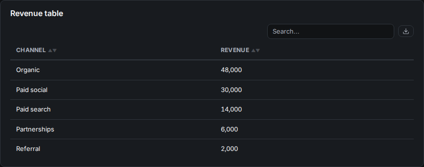 | 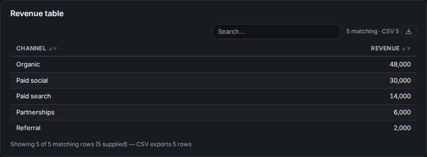 | 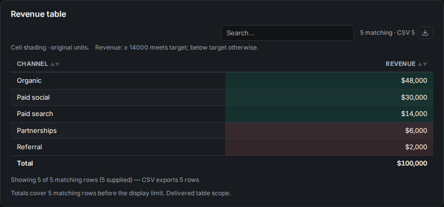 |
| Doughnut | 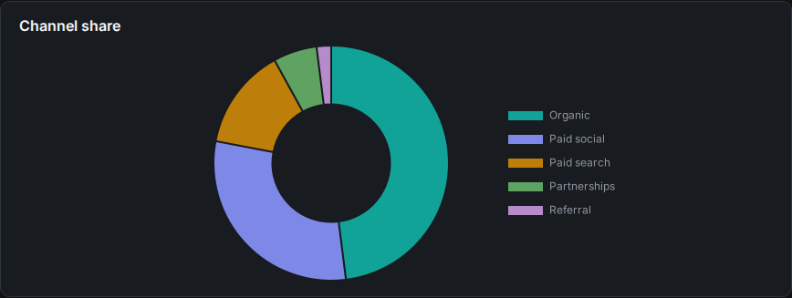 | 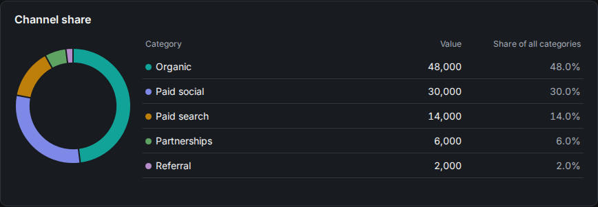 | 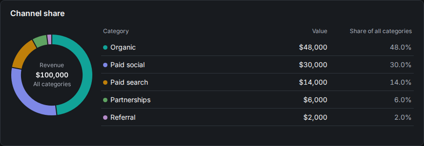 |
| Line | 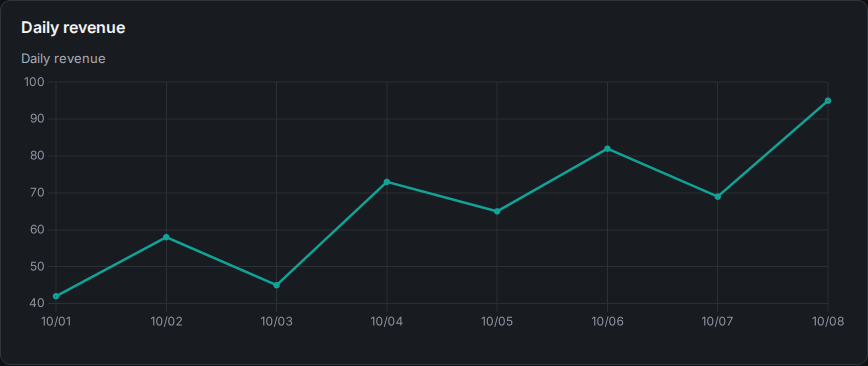 | 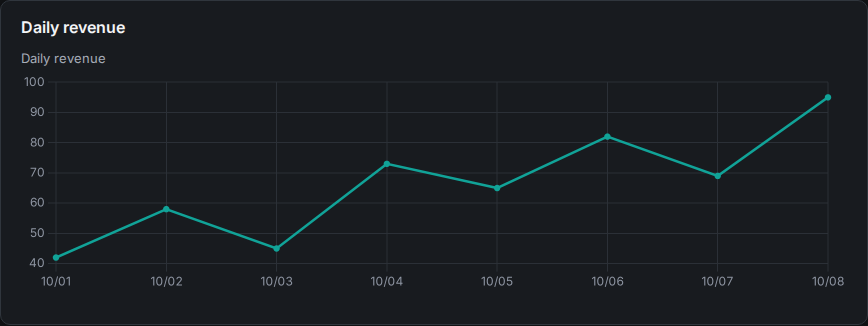 | 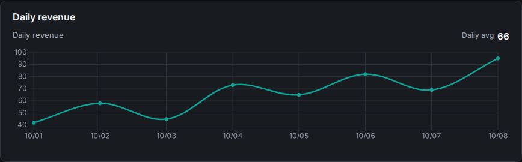 |

Table rows become denser, though the new population context also occupies space.
The doughnut legend adds readable numbers without needing hover. The optional
line average is computed from the plotted series; it does not alter that series.

Automatic grids now preserve the individual charts' titles and plotting heights:

| Real v0.9.5 automatic grid | Current automatic grid |
| --- | --- |
| 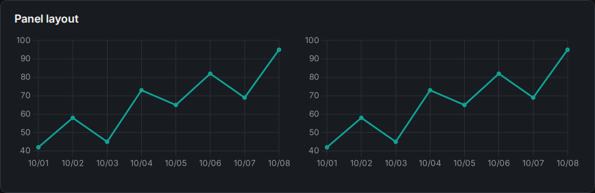 | 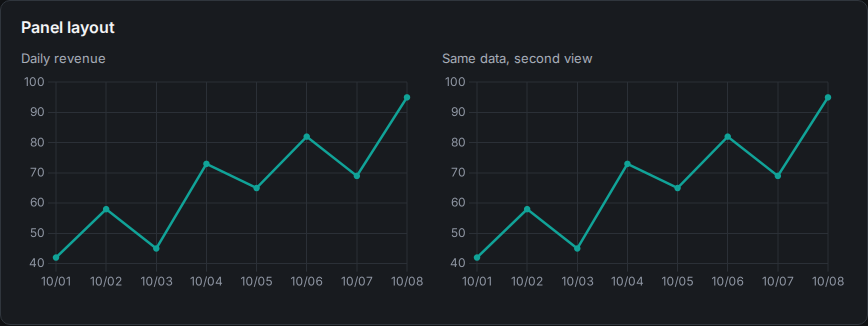 |

The layout example uses `Grid(children, columns=2, min_width=320)` unchanged.
If an old automatic grid relied on `columns` being ignored to fit four tiles,
set `columns=4` explicitly.

| Real v0.9.5 tabs | Current tabs | Opt-in sidebar |
| --- | --- | --- |
| 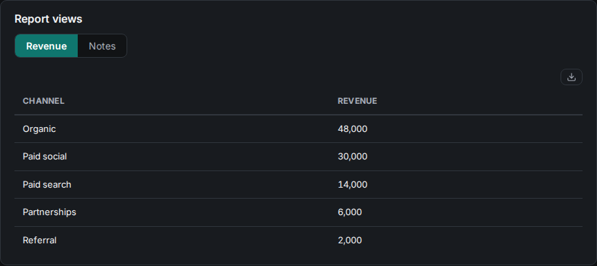 | 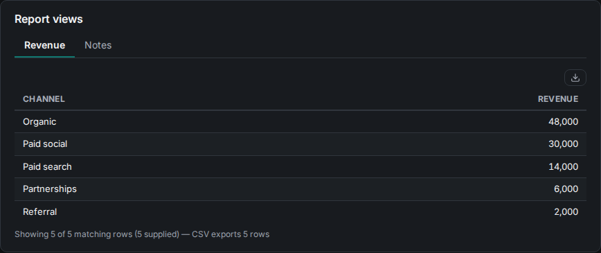 | 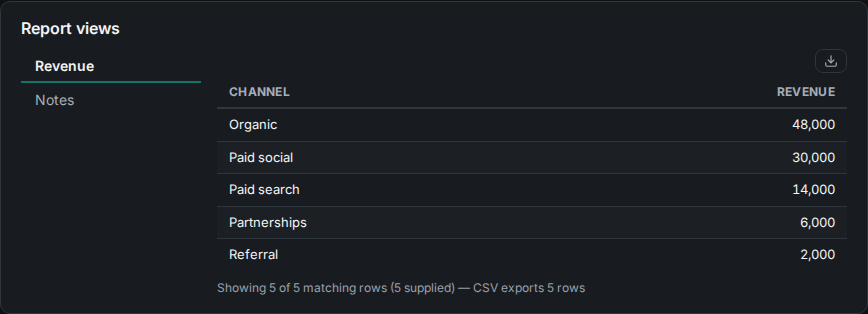 |

At **390px in Trellum Light**, every doughnut category remains available. A
stacked legend can make the component taller even though its ring is smaller:

| Real v0.9.5 | Current default | Current with total |
| --- | --- | --- |
| 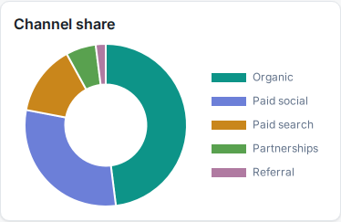 | 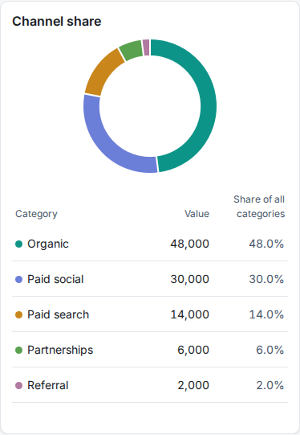 | 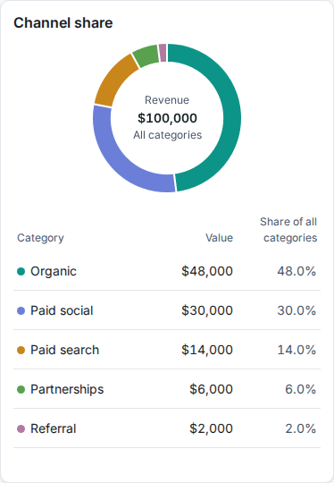 |

## Small, explicit additions

The screenshot examples use `channels`, a frame with `Channel` and numeric
`Revenue` columns, and `daily`, with ISO `day` and numeric `revenue` columns.
These examples are static snapshots; use the normal `DataSource` / `dataset_id`
contract when the report should respond to filters.

```python
from trellum.components import DataTable, DoughnutChart, LineChart

DataTable(channels, "Revenue by channel", static=True,
          sortable=True, searchable=True,
          column_formats={"Revenue": {"format": "currency", "precision": 0}},
          totals={"Revenue": {"agg": "sum", "format": "currency", "precision": 0}},
          cell_shading={"Revenue": {"target": 14000, "direction": "higher"}})

DoughnutChart(channels, "Channel", "Revenue", "Revenue by channel", static=True,
              center_total=True, center_label="Revenue",
              value_format="currency", precision=0)

LineChart(daily, "day", "revenue", "Daily revenue", static=True,
          height="compact", tension=0.35,
          header_summary={"stat": "mean", "series": 0,
                          "label": "Daily avg", "format": "number"})
```

Only declare sums/center totals for additive quantities. Table totals cover
matching delivered rows before the display limit; ratio totals require explicit
numerator and denominator declarations. Doughnut shares and totals include
legend-hidden categories in the current result. Hiding an arc changes visibility,
not filters or CSV. Complete finite nonnegative values are required for meaningful
part-to-whole context; existing signed/incomplete arc semantics remain unsupported.

Curves interpolate between observations and can overshoot; they are not averages
or forecasts. Keep the straight default when that inference is undesirable.
See [tables](report-data-tables.md), [doughnuts](report-doughnuts.md),
[line styles](report-line-styles.md), [layouts](report-layouts.md) and
[controls](report-controls.md) for the precise contracts.

## Upgrade and check

```sh
python -m trellum.run reports/<slug> --no-serve
python -m trellum validate reports/<slug>
```

Check existing explicit `LineChart.colors` in dataset-bound unsplit value/ratio
charts: those lists previously were ignored and now apply. Omitted/empty lists and
missing entries in short lists retain theme fallback; active category splits keep
category mapping precedence. This compatibility correction is not illustrated by
the frozen captures above.

Check the rebuilt report at desktop and phone widths, especially automatic grids,
long legends and custom CSS. Review static tables that relied on `max_rows` to
truncate payloads or CSV: it now only bounds display, and `columns` selects both
static display and export columns. Numeric sorting uses raw values, which can
change an order previously based on rounded display text. Keep source/query
bounds for genuinely large populations.

The comparison fixtures built with zero validation FAILs and WARNs. Chromium
captures at 900px/dark and 390px/light had no page errors; ring and line values
matched across versions. The optional line used a 160px plot in both captures;
the default used 220px in both. This guide does not claim a complete visual or
calculation audit of every component, custom stylesheet or existing report.
